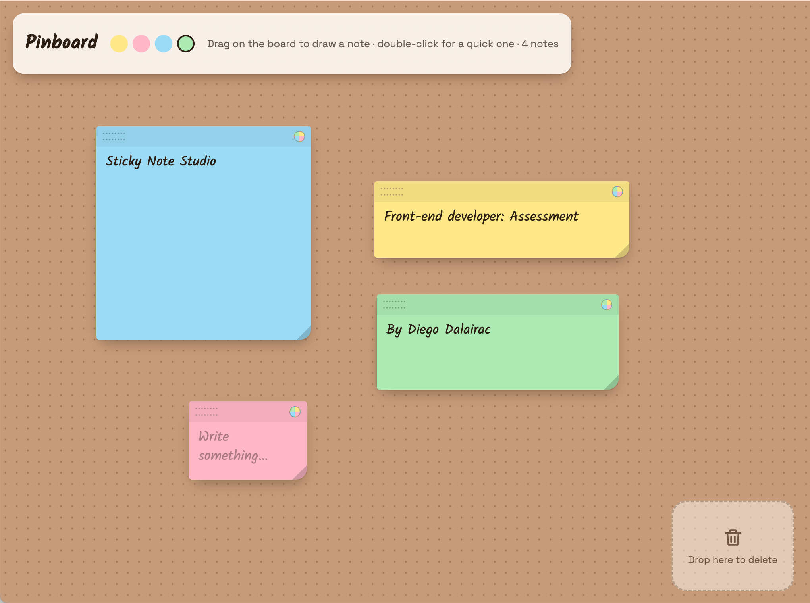

# Sticky Note Studio



A single-page desktop app for sticky notes, built with React and TypeScript. Notes live on a board: draw one at any size and position, drag it, resize it from the corner, or drop it on the trash zone to delete it. Text, color, and stacking order are editable, and every change is persisted through an asynchronous mock of a REST API that stores notes in `localStorage` and restores them on load.

There is no UI component library. Domain logic (types, geometry, pointer tracking, the notes reducer, and the persistence API) lives in `src/notes/`; components in `src/components/` only render that state.

## Docs

- [BRIEF.md](./BRIEF.md) — the original task: required features, system requirements, and optional bonuses.
- [ARCHITECTURE.md](./ARCHITECTURE.md) — how the app is structured, how dragging stays fast, and how persistence is isolated behind `NotesApi`.

## Run locally

You need Node.js and npm. [nvm](https://github.com/nvm-sh/nvm#installing-and-updating) is a convenient way to install them.

```sh
git clone https://github.com/ddalairac/sticky-note-studio
cd sticky-note-studio
npm install
npm run dev
```

The dev server prints a local URL (Vite's default is http://localhost:5173). The board is meant for a desktop viewport of at least 1024×768.

Other scripts:

| Command              | What it does                       |
| -------------------- | ---------------------------------- |
| `npm test`           | Run the test suite once            |
| `npm run test:watch` | Re-run tests on change             |
| `npm run lint`       | Lint the project                   |
| `npm run build`      | Production build into `dist/`      |
| `npm run preview`    | Serve the production build locally |

## Deploy

The build is a static site. Pushing to `main` runs `.github/workflows/deploy.yml`, which lints, tests, builds and publishes `dist/` to GitHub Pages. Enable it once under **Settings → Pages → Source: GitHub Actions**.
